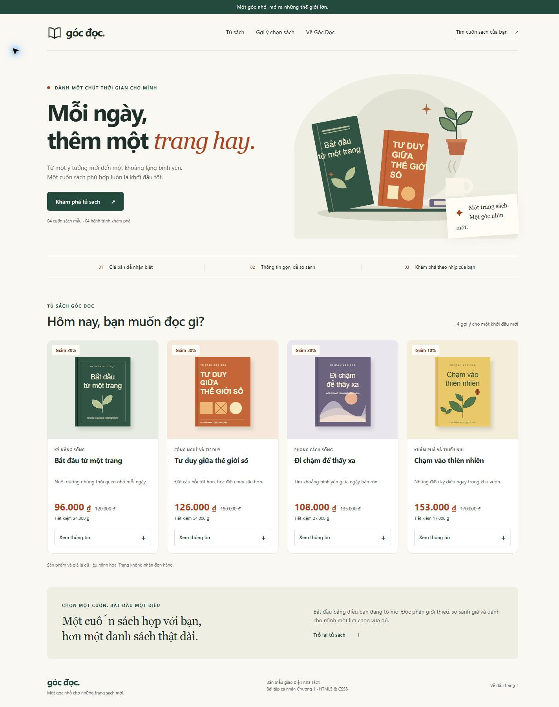

# Báo cáo khảo sát FAHASA và cải tiến giao diện nhà sách Góc Đọc

Bài tập cá nhân Chương 1 - Phát triển ứng dụng WEB/TMĐT

- Họ và tên: sinh viên bổ sung.
- MSSV: sinh viên bổ sung.
- Lớp: sinh viên bổ sung.
- Ngày khảo sát: 18/10/2026.

## 1. Mục tiêu và phạm vi

Bài tập khảo sát năm khu vực mua sắm trên FAHASA và xây dựng một trang nhà sách mẫu bằng HTML5/CSS3. Phương án tập trung vào thẻ sản phẩm: tên sách dễ đọc, giá bán nổi bật, phân biệt giá gốc và thêm số tiền tiết kiệm. Trang sử dụng bốn sách giả định và ảnh SVG tự tạo. Không có backend, cơ sở dữ liệu, đăng nhập hoặc thanh toán.

## 2. Khảo sát

# Khảo sát website FAHASA

## 1. Thông tin chung

- Website: FAHASA, https://www.fahasa.com/.
- Thời điểm quan sát: 18/10/2026, múi giờ Việt Nam (UTC+7).
- Phạm vi: giao diện web trong phiên khách, không đăng nhập. Cửa sổ khảo sát ở dạng hẹp; không suy rộng các nhận xét này cho mọi thiết bị.
- Hàng hóa quan sát được: sách tiếng Việt, sách ngoại văn, văn phòng phẩm, đồ chơi và một số nhóm hàng khác.
- Khách hàng mục tiêu **suy luận từ danh mục**: học sinh, sinh viên, phụ huynh, người đọc sách và người có nhu cầu học ngoại ngữ. Đây không phải số liệu nhân khẩu học do FAHASA công bố.
- Chức năng mua sắm đã quan sát: xem nhóm sản phẩm, xem bộ lọc/sắp xếp, tìm kiếm, xem chi tiết sách, thêm sách vào giỏ, chọn dòng hàng và xem tổng tiền. Chưa kiểm tra thanh toán, giao hàng thực tế hay tài khoản thành viên.

## 2. Bảng khảo sát năm khu vực

“Quan sát” là nội dung trợ lý đã kiểm tra trên website; các cột đánh giá và đề xuất là phân tích thiết kế. Sinh viên cần xem lại website và bổ sung nhận xét của mình.

| Khu vực | Chức năng và quan sát thực tế | Điểm hợp lý | Điểm có thể cải thiện | Đề xuất và lý do |
| --- | --- | --- | --- | --- |
| Trang chủ | Có ô tìm kiếm ở đầu trang, banner chương trình, lối vào danh mục, Flash Sale và các nhóm sách. Phiên quan sát xuất hiện quảng cáo nổi và lớp hướng dẫn nhận thông báo. | Các lối vào nhóm hàng và chương trình mua sắm giúp người xem bắt đầu theo nhu cầu. | Nội dung nổi có thể che phần sản phẩm trong lần truy cập đầu; đây là nhận xét từ phiên đã ghi ảnh, không phải mọi lần truy cập. | Ưu tiên nội dung chính và giảm lớp phủ ở màn hình nhỏ để người xem tiếp cận danh sách sách sớm hơn. |
| Danh mục | Trang Sách tiếng Việt có nhóm sản phẩm, các khoảng giá, nhà cung cấp; thấy lựa chọn Bán Chạy Tuần và 24 sản phẩm. Thẻ sách có tên, giá, giảm giá. | Có nhiều tiêu chí để thu hẹp danh sách và so sánh sách. | Tại trạng thái cửa sổ hẹp đã mở, khối bộ lọc chiếm phần lớn màn hình; có các tên sản phẩm kèm nhiều thông tin tặng kèm. | Gom bộ lọc trong vùng mở/đóng trên màn hình nhỏ; tách tên sách chính và thông tin phụ để dễ quét mắt. Chưa đánh giá độ chính xác của từng bộ lọc. |
| Chi tiết sản phẩm | Sách Giáo Trình New HSK 2 có ảnh, chọn phân loại, tên, giá bán 196.200 ₫, giá gốc 218.000 ₫, giảm 10%, thông tin chi tiết và mô tả; có Thêm vào giỏ hàng và Mua ngay. | Giá và thông tin sách được chia thành các khu vực; có thao tác mua và chọn phân loại. | Nội dung dài và thông tin khuyến mãi có thể làm người mua mất thời gian xác định thông tin cốt lõi. Đây là đánh giá thiết kế, chưa đo thời gian thực hiện. | Đưa quy cách, giá và số tiền tiết kiệm vào một nhóm dễ đọc; chia nội dung dài thành các vùng mở rộng. |
| Tìm kiếm | Nhập “lập trình” và gửi tìm kiếm; trang trả về 33 kết quả tại thời điểm kiểm tra, có nhóm Sách tiếng Việt/Đồ Chơi, Độ liên quan và Còn hàng. | Hiển thị lại từ khóa, số kết quả và các lựa chọn thu hẹp. | Cùng từ khóa có nhiều nhóm hàng; người tìm sách có thể cần thêm bước giới hạn nhóm. | Làm rõ nhóm đang chọn và cho phép bỏ lọc dễ nhận biết. Không kết luận website chưa có tìm kiếm gợi ý, sửa lỗi chính tả hoặc xử lý không có kết quả vì chưa kiểm tra các trường hợp đó. |
| Giỏ hàng | Kiểm tra giỏ trống, sau đó thêm 1 cuốn New HSK 2. Có tên, giá, ô số lượng, hộp chọn và xóa. Tổng tiền là 0 ₫ khi chưa chọn; sau khi chọn dòng hàng, tổng là 196.200 ₫. Đã xóa sản phẩm thử để trả giỏ về trống. | Người mua chủ động chọn sản phẩm để tính tiền; có tổng và thao tác tiếp tục mua khi giỏ trống. | Trong trạng thái đã thử, người mới có thể băn khoăn khi có sản phẩm nhưng tổng tiền còn 0 ₫ vì chưa chọn dòng hàng. | Thêm hướng dẫn gần tổng tiền: “Chọn sản phẩm để tính tổng”, kèm số sản phẩm đã chọn. Tách giá trị hàng và phí vận chuyển nếu có số liệu đã xác định. Không coi tổng đang thấy là số tiền thanh toán cuối cùng. |

## 3. Nguồn và minh chứng

| Mã | Trang | Đường dẫn | Ảnh |
| --- | --- | --- | --- |
| S1 | Trang chủ | https://www.fahasa.com/ | `evidence/01-trang-chu.png` |
| S2 | Danh mục | https://www.fahasa.com/sach-trong-nuoc.html | `evidence/02-danh-muc.png` |
| S3 | Chi tiết | https://www.fahasa.com/giao-trinh-new-hsk-2.html | `evidence/03-chi-tiet.png` |
| S4 | Tìm kiếm | https://www.fahasa.com/searchengine?q=l%E1%BA%ADp%20tr%C3%ACnh | `evidence/04-tim-kiem.png` |
| S5 | Giỏ hàng | https://www.fahasa.com/checkout/cart/ | `evidence/05-gio-hang-trong.png`, `evidence/06-gio-hang-co-san-pham.png` |

Ảnh chụp chỉ là một trạng thái của trang, không thể hiện toàn bộ chức năng. Giá, số lượng kết quả và chương trình có thể thay đổi. Các thao tác được thực hiện trong phiên khách, không đặt hàng hay thanh toán.

## 4. Vấn đề được chọn cho bài thực hành

Chọn **cách trình bày thẻ sách và giá trên màn hình nhỏ**. Danh sách sách có nhiều thông tin; bài thực hành thử một phương án tối giản, giữ tên sách, nhóm nội dung, giá bán, giá gốc, giảm giá và nút xem thêm. Trang mẫu bổ sung số tiền tiết kiệm và chuyển về một cột trên điện thoại nhỏ. Mục tiêu là giảm thao tác tính nhẩm và dành đủ diện tích cho thông tin chính.

Các lợi ích này là mục tiêu thiết kế. Bài chưa có thử nghiệm người dùng để khẳng định tăng tỷ lệ mua hàng hay mức độ hài lòng.

## 3. Phương án giao diện và mã nguồn

Mẫu **Góc Đọc** có bốn sản phẩm: Bắt đầu từ một trang; Tư duy giữa thế giới số; Đi chậm để thấy xa; Chạm vào thiên nhiên. Mỗi sản phẩm có ảnh SVG, tên, giá bán, giá gốc, mức giảm, số tiền tiết kiệm và nút Xem thông tin.

| Sách | Giá gốc | Giá bán | Giảm | Tiết kiệm |
| --- | --- | --- | --- | --- |
| Bắt đầu từ một trang | 120.000 ₫ | 96.000 ₫ | 20% | 24.000 ₫ |
| Tư duy giữa thế giới số | 180.000 ₫ | 126.000 ₫ | 30% | 54.000 ₫ |
| Đi chậm để thấy xa | 135.000 ₫ | 108.000 ₫ | 20% | 27.000 ₫ |
| Chạm vào thiên nhiên | 170.000 ₫ | 153.000 ₫ | 10% | 17.000 ₫ |

HTML dùng header, nav, main, section, article và footer để tổ chức nội dung. img/alt thể hiện hình và mô tả ảnh; del đánh dấu giá gốc. details/summary cho phép mở và đóng thông tin bằng HTML thuần. CSS tách trong css/style.css, dùng Grid, Flexbox và media query. Các giá là nội dung tĩnh; sửa giá cần cập nhật những con số liên quan.

Bố cục có bốn cột trên màn hình lớn, hai cột ở kích thước vừa và một cột khi chiều rộng không quá 480 px. Liên kết bỏ qua điều hướng, nhãn ảnh và focus-visible hỗ trợ thao tác bàn phím.

## 4. Sử dụng AI và kiểm tra

ChatGPT trong Codex hỗ trợ đọc đề, khảo sát, phân tích, tạo mã, giải thích và kiểm tra. Prompt gốc cùng phạm vi hỗ trợ được lưu trong AI_USAGE.md. Các prompt bổ sung trong tệp đó là mẫu để sinh viên sử dụng tiếp, không được ghi là người học đã tự nhập.

Trợ lý đã kiểm tra trên Chrome ở chiều rộng 1440, 768, 390 và 320 px; không phát hiện tràn ngang toàn trang trong các trường hợp đã thử. Hình tải được và Enter mở/đóng được thông tin cả bốn sách. Đây là kiểm tra bằng viewport, không phải trên điện thoại vật lý. Chi tiết và phần dành cho sinh viên ở KIEM_TRA.md.

### Phần sinh viên tự thực hiện

- Ngày tự kiểm tra:
- Vấn đề bản thân phát hiện:
- Tệp và đoạn mã đã sửa:
- Lý do sửa:
- Vai trò của thuộc tính HTML/CSS đã sửa:
- Kết quả sau khi sửa:
- Ảnh trước và sau:

Chỉ điền sau khi tự thực hiện. Không ghi phần khảo sát hoặc thay đổi của trợ lý thành phần mình đã làm.

## 5. Chạy trong VS Code và công khai trên GitHub

Giải nén, dùng File > Open Folder để mở thư mục dự án trong VS Code. Mở index.html bằng Chrome hoặc dùng Live Server nếu đã có. Không cần cài thư viện.

Tạo repository riêng ở chế độ Public, tải các tệp và thư mục lên, giữ index.html cùng README.md tại thư mục gốc. Xem HUONG_DAN_VSCODE_VA_GITHUB.md để thực hiện bằng giao diện GitHub hoặc Git. GitHub Pages là phần tùy chọn trong đề.

- Repository Public: sinh viên bổ sung URL thật sau khi tạo.
- GitHub Pages: sinh viên bổ sung URL thật nếu triển khai.

Repository chưa được đăng trong phiên này vì sinh viên bổ sung tài khoản sau. Cần bổ sung thông tin cá nhân, tự kiểm tra và một chỉnh sửa do mình phát hiện trước khi nộp.

## 6. Tài liệu tham khảo

- Đề bài BaiTap_CaNhan_Chuong1.pdf do người học cung cấp, 11 trang.
- Các nguồn S1 đến S5 và ảnh tương ứng được ghi tại phần khảo sát.
- [GitHub Pages Quickstart](https://docs.github.com/en/pages/quickstart).
- [Creating a new repository](https://docs.github.com/en/repositories/creating-and-managing-repositories/creating-a-new-repository).

Khi sửa báo cáo Markdown, cần cập nhật PDF tương ứng nếu sử dụng PDF để nộp.
