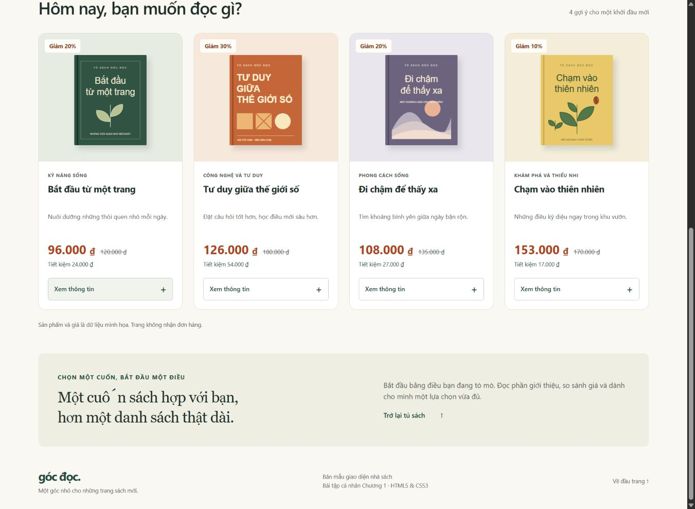
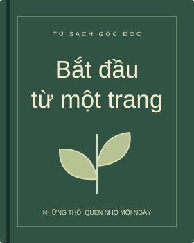
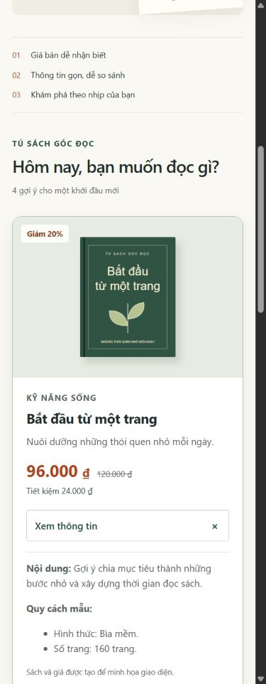
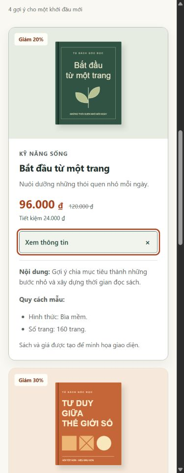
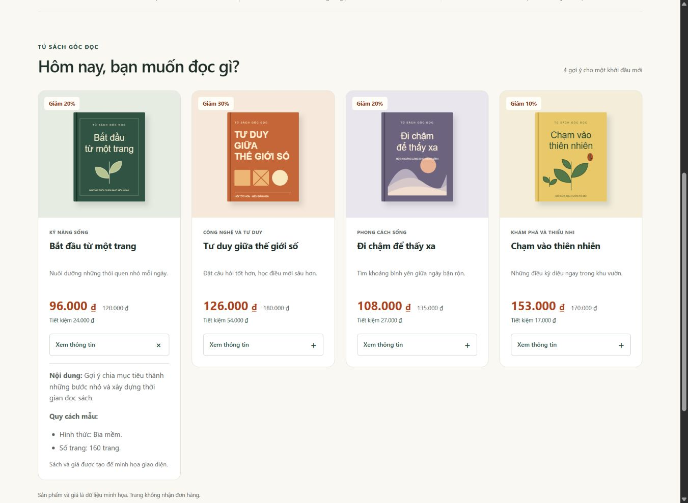
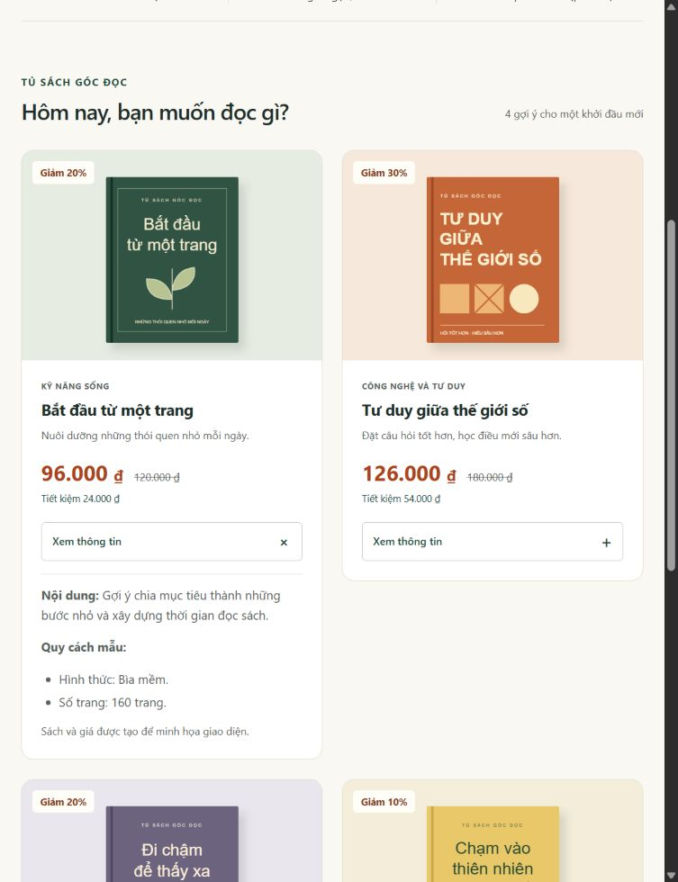
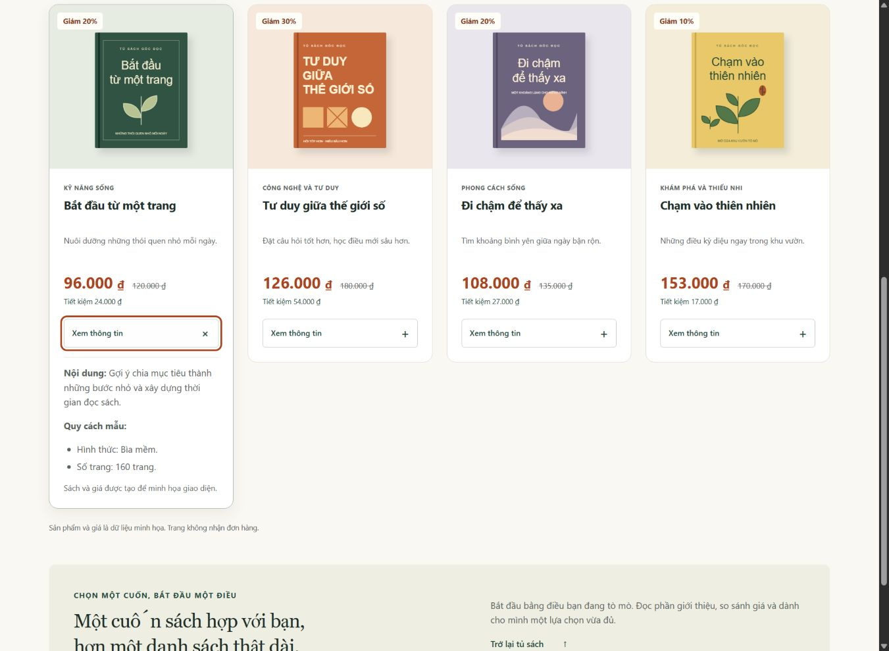

# BÀI TẬP CÁ NHÂN BUỔI 2

**HTML5 và CSS3**

**Hoàn thiện giao diện nhà sách Góc Đọc**

Sinh viên: **Nguyễn Phan Tân Thành**. MSSV: **31241022712**. Lớp: **................................**.

Ngày thực hiện báo cáo: 02/11/2026.

## 1. Mục tiêu học tập

Bài tập tiếp tục phát triển giao diện Góc Đọc đã xây dựng ở Buổi 1. Nội dung thực hành tập trung vào cấu trúc HTML5, liên kết CSS, selector, Box Model, Flexbox và Grid. Các thay đổi được kiểm tra trên nhiều kích thước màn hình, kèm hình ảnh trước và sau khi điều chỉnh.

## 2. Sản phẩm tiếp tục từ Buổi 1

Góc Đọc là giao diện nhà sách mẫu tham khảo FAHASA, sử dụng bốn sách và hình SVG minh họa. Khu vực trọng tâm là danh sách và thẻ sách. Bản Buổi 2 giữ các hình, tên, giá, ID và điều hướng của bài cũ.

Ở phiên bản kế thừa, thẻ sách đầu tiên đã có danh sách quy cách. Ba thẻ còn lại được điều chỉnh theo cùng cấu trúc, kết hợp hoàn thiện khoảng cách, cỡ chữ và trạng thái tương tác.

## 3. Các bước thực hiện chi tiết

Quá trình thực hiện bắt đầu bằng việc rà soát giao diện và mã nguồn, sau đó lựa chọn các điểm cần hoàn thiện. Các bước tiếp theo tập trung vào cấu trúc thẻ sách, cách tổ chức CSS, bố cục và kiểm thử. Những yêu cầu tham khảo gửi AI được đặt tại từng bước; nhật ký yêu cầu thực tế được lưu trong AI_USAGE.md.

ChatGPT được sử dụng để hỗ trợ phân tích, chỉnh sửa mã và kiểm tra kỹ thuật. Các ảnh minh chứng cùng số đo trong bảng kiểm thử được thu thập trong quá trình kiểm thử có hỗ trợ AI. Việc tự điều chỉnh của sinh viên và trạng thái GitHub được ghi nhận riêng ở mục 11 và mục 14.


## 4. Bước 1. Rà soát bài Buổi 1 và xác định nội dung cần cải thiện

### 4.1. Công việc và kết quả rà soát

Website đã có đầu trang, menu, phần giới thiệu, bốn thẻ sách, hình ảnh, các loại giá, nút mở thông tin, phần gợi ý và chân trang. Mã có header/nav/main/section/article/footer, ảnh có alt, CSS ngoài, Flexbox và Grid. Vì vậy, hướng thực hành là điều chỉnh và giải thích phần đã có, không coi các thành phần này là thiếu.

| Vấn đề trong bản trước | Hướng cải thiện | Kết quả mong muốn |
|---|---|---|
| Ba thẻ còn viết dồn dòng, quy cách chưa đồng nhất với sách đầu | Định dạng HTML, tổ chức quy cách bằng ul/li cho cả bốn | Dễ đọc mã và hiểu quan hệ nội dung |
| Ghi chú cuối vẫn 11 px trên màn hình nhỏ | Sửa trực tiếp selector của đoạn cuối trong media query | Ghi chú 13 px tại 390 px |
| Nền summary đổi ngay, chưa có transition riêng | Thêm transition nền/viền và kiểm tra focus | Phản hồi tương tác rõ và nhẹ |

Ba điểm trên liên quan trực tiếp đến cấu trúc thẻ, khả năng đọc nội dung và phản hồi khi tương tác. Hình 4.1 ghi lại danh sách sách trước khi điều chỉnh.



*Hình 4.1. Danh sách thẻ sách trước khi điều chỉnh.*

### 4.2. Prompt 1 - Phân tích mã nguồn hiện tại


Phân tích index.html và css/style.css của Góc Đọc. Giữ website và dữ liệu Buổi 1. Xác định thành phần đã có, phân biệt lỗi và đề xuất cải thiện, nêu ít nhất ba vấn đề có căn cứ trong mã. Lập bảng vấn đề, hướng cải thiện, kết quả mong muốn. Chưa viết lại website.


Từ kết quả rà soát, quy trình chỉnh sửa được triển khai theo thứ tự: lưu phiên bản ban đầu, làm rõ cấu trúc HTML, điều chỉnh CSS và kiểm tra lại giao diện.


## 5. Bước 2. Củng cố cấu trúc HTML5 có ngữ nghĩa

### 5.1. Công việc thực hiện

Tài liệu có DOCTYPE HTML, lang="vi", UTF-8, viewport, title và link stylesheet. Các vùng có ngữ nghĩa được giữ đúng vai trò. h1 là tiêu đề chính, h2 là tiêu đề khu vực và h3 là tên sách. Mỗi img có alt riêng; các a dẫn đến ID đang tồn tại trong trang.


| Phần tử | Vai trò trong Góc Đọc |
|---|---|
| header | Tên nhà sách và khu vực đầu trang. |
| nav | Nhóm liên kết tới các khu vực chính. |
| main | Nội dung chính của website. |
| section | Khu vực giới thiệu, tủ sách và gợi ý chọn sách. |
| article | Một thẻ sách với nội dung tương đối độc lập. |
| footer | Thông tin cuối trang và liên kết về đầu trang. |

Quy cách của cả bốn sách được tổ chức bằng ul/li. Mã mỗi article được xuống dòng, thụt lề và chia nhóm ảnh, nội dung, giá và thông tin mở rộng. Div dùng để nhóm trình bày, không cần thay mọi div bằng section. Danh sách ul đặt trong div.details-content, không đặt trong p.

```html
<article class="product-card" aria-labelledby="book-1-title">
  <div class="product-image sage">
    <span class="discount">Giảm 20%</span>
    
  </div>

  <div class="product-body">
    <p class="category">KỸ NĂNG SỐNG</p>
    <h3 id="book-1-title">Bắt đầu từ một trang</h3>
    <p class="book-description">Nuôi dưỡng những thói quen nhỏ mỗi ngày.</p>

    <!-- Flexbox căn giá bán và giá gốc theo đường cơ sở chữ -->
    <div class="price-block">
      <p class="sale-price">
        <span class="sr-only">Giá bán </span>96.000 <span>₫</span>
      </p>
      <p class="original-price">
        <span class="sr-only">Giá gốc </span><del>120.000 ₫</del>
      </p>
    </div>
    <p class="saving">Tiết kiệm 24.000 ₫</p>

    <details class="book-details">
      <summary aria-label="Xem thông tin sách Bắt đầu từ một trang">
        Xem thông tin <span aria-hidden="true">+</span>
      </summary>
      <div class="details-content">
        <p><strong>Nội dung:</strong> Gợi ý chia mục tiêu thành những bước nhỏ và xây dựng thời gian đọc sách.</p>
        <p><strong>Quy cách mẫu:</strong></p>
        <ul class="book-specs">
          <li>Hình thức: Bìa mềm.</li>
          <li>Số trang: 160 trang.</li>
        </ul>
        <p>Sách và giá được tạo để minh họa giao diện.</p>
      </div>
    </details>
  </div>
</article>
```

Đoạn mã trên minh họa thẻ sách đầu tiên sau khi chỉnh sửa, có hình ảnh, mô tả thay thế, giá và phần thông tin mở rộng. Article thể hiện một nội dung sản phẩm tương đối độc lập, nav là vùng điều hướng, ul là danh sách không có thứ tự. Alt cung cấp mô tả thay thế cho ảnh.

### 5.2. Prompt 2 - Kiểm tra cấu trúc HTML5


Kiểm tra các vùng header/nav/main/section/article/footer, thứ bậc h1-h3, img/alt, liên kết nội trang và cách lồng thẻ. Tập trung thẻ sách. Đề xuất cách tổ chức quy cách thành ul/li khi phù hợp. Giải thích từng thay đổi, không tạo thêm trang hay thẻ chỉ để đủ số lượng.


Cấu trúc hiện có phân chia rõ vùng nội dung chính và các thẻ sản phẩm. Việc chuyển quy cách sách thành danh sách giúp các thông tin cùng nhóm được nhận diện rõ; cách viết bằng đoạn văn trước đó vẫn phù hợp về cú pháp.

### Trả lời câu hỏi tự kiểm tra về HTML5

**Vì sao dùng nav?** Nav đánh dấu vùng điều hướng chính. Trong bài, các liên kết giúp chuyển tới tủ sách, gợi ý và thông tin cuối trang.

**Article khác div thế nào?** Article biểu thị một nội dung tương đối độc lập như một thẻ sản phẩm. Div nhóm các phần tử để tổ chức và định dạng, không tự mang ý nghĩa nội dung độc lập.

**Vì sao cần alt?** Alt cung cấp mô tả thay thế cho ảnh và công nghệ hỗ trợ. Mỗi bìa sách trong bài có mô tả riêng.

**Khi nào dùng ul/li?** Khi các mục tạo thành danh sách không cần thứ tự. Quy cách sách gồm hình thức và số trang phù hợp với cách tổ chức này.


## 6. Bước 3. Tạo và liên kết tệp CSS

### 6.1. Công việc thực hiện

Giữ css/style.css đã có từ Buổi 1. HTML dùng link rel="stylesheet" với href="css/style.css" trong head. Body có margin 0, font Segoe UI/Arial/sans-serif, cỡ 16 px, line-height 1.6, nền var(--paper) và chữ var(--ink). Các biến này lần lượt mang giá trị #faf8f3 và #202e2a. Img có max-width 100% và height auto, kết hợp quy tắc ảnh riêng của thẻ sách.

Cấu trúc thư mục sử dụng:

```text
ecommerce-ui-improvement/
  index.html
  css/
    style.css
  images/
    book-01.svg ... book-04.svg
```

Liên kết trong phần head:

```html
<link rel="stylesheet" href="css/style.css">
```

Các quy tắc CSS cơ bản:

```css
body {
  margin: 0;
  background: var(--paper);
  color: var(--ink);
  font-family: "Segoe UI", Arial, sans-serif;
  font-size: 16px;
  line-height: 1.6;
}
img {
  display: block;
  max-width: 100%;
  height: auto;
}
```

### 6.2. Prompt 3 - Tạo CSS cơ bản


Dự án có index.html, css/style.css và images/. Kiểm tra link stylesheet, đường dẫn tương đối; giải thích body, margin, màu nền, màu chữ, font-family, line-height và img max-width/height. Giữ CSS đã có, chỉ đề xuất phần cần thiết. Không Bootstrap/Tailwind. Hướng dẫn kiểm tra bằng trình duyệt.


Đường dẫn và computed style cho thấy các quy tắc CSS đã được áp dụng. Khi kiểm tra một thay đổi, tệp cần được lưu và trang cần được tải lại; nếu kết quả chưa xuất hiện, có thể kiểm tra đường dẫn, cú pháp và các quy tắc ghi đè.

## 7. Bước 4. Thực hành CSS selector và Box Model

### 7.1. Công việc thực hiện

Element selector có body và img. Class selector có .product-body và .book-specs. Descendant selector .book-specs li chọn các mục nằm trong danh sách quy cách. Selector tên sách được giới hạn thành .product-card h3, kể cả trong các media query.

```css
.product-body { padding: 22px; }
.book-specs {
  margin: 8px 0 12px;
  padding-inline-start: 20px;
}
.book-specs li { line-height: 1.6; }
.book-specs li + li { margin-top: 4px; }
```

Padding nằm giữa nội dung và viền; margin tạo khoảng cách bên ngoài viền. Card kế thừa border 1 px, border-radius 14 px và nền trắng. Body nội dung có padding 22 px thay cho giá trị cũ 20/18/18 px trên máy tính và 20 px trên điện thoại. Box-sizing border-box tính padding và border vào width/height khai báo, không tính margin.



*Hình 7.1. Trước chỉnh sửa ở 390 px.*



*Hình 7.2. Sau chỉnh sửa ở 390 px.*

### 7.2. Prompt 4 - Selector và Box Model


Dùng HTML của một article.product-card và CSS liên quan. Chỉ ra element selector, class selector, descendant selector. Giải thích margin/padding/border/border-radius và border-box. Đề xuất CSS ngắn cho nội dung thẻ và danh sách quy cách, không thay sách hay tạo lại HTML.


Bố cục thẻ sử dụng padding để tạo khoảng trống bên trong, còn khoảng cách giữa các thẻ do gap của Grid đảm nhiệm. Hình 7.1 và Hình 7.2 thể hiện giao diện ở 390 px trước và sau khi điều chỉnh.


## 8. Bước 5. Thực hành Flexbox ở mức cơ bản

### 8.1. Công việc thực hiện

Chọn .price-block gồm hai phần tử giá bán và giá gốc. Đây là khu vực nhỏ phù hợp yêu cầu. Flexbox vốn có ở Buổi 1 được giữ, bổ sung justify-content rõ ràng và điều chỉnh gap.

```css
.price-block {
  display: flex;
  flex-wrap: wrap;
  justify-content: flex-start;
  align-items: baseline;
  gap: 6px 12px;
}
```

Display flex đặt trên phần tử cha. Trong chiều row mặc định, justify-content căn theo trục chính ngang; flex-start đặt giá về đầu nhóm. Align-items baseline căn đường cơ sở chữ dù cỡ giá khác nhau. Gap tạo khoảng cách giữa các mục, không tạo khoảng cách ngoài cả nhóm như margin. Flex-wrap cho phép giá xuống dòng khi thiếu chỗ.



*Hình 8.1. Nhóm giá trong thẻ sách sau khi áp dụng Flexbox.*

### 8.2. Prompt 5 - Thực hành Flexbox


Dùng .price-block chứa giá bán và giá gốc. Hướng dẫn đặt display:flex trên phần tử cha, justify-content, align-items:baseline, flex-wrap và gap. So sánh flex-start với space-between, dự đoán kết quả trước khi thử. Chỉ sửa nhóm thông tin đang có.


Với flex-start, hai mức giá được đặt về đầu nhóm. Nếu chuyển sang space-between và còn khoảng trống, hai mục sẽ được phân bố về hai đầu trục chính. Quy tắc đang sử dụng trong sản phẩm là flex-start.

### Trả lời câu hỏi tự kiểm tra về Flexbox

Display flex đặt trên phần tử cha để các phần tử con trực tiếp trở thành flex item. Space-between phân bố khoảng trống giữa các mục và đặt mục đầu, cuối về hai đầu trục chính khi đủ không gian. Gap tạo khoảng cách giữa các mục, còn margin có thể tạo khoảng cách ngoài một mục, kể cả ở mép nhóm.

## 9. Bước 6. Hoàn thiện danh sách sản phẩm bằng CSS Grid

### 9.1. Công việc thực hiện

Grid là phần mở rộng trong đề. Bài đã có danh sách bốn article trong .product-grid nên tiếp tục sử dụng. Mặc định là repeat(4, minmax(0, 1fr)), gap 22 px. Các quy tắc cụ thể:

```css
.product-grid {
  display: grid;
  grid-template-columns: repeat(4, minmax(0, 1fr));
  gap: 22px;
}
@media (max-width: 1050px) {
  .product-grid {
    grid-template-columns: repeat(2, minmax(0, 1fr));
  }
}
@media (max-width: 480px) {
  .product-grid { grid-template-columns: 1fr; }
}
```

Ở chiều rộng không quá 700 px, khoảng gap được quy định riêng là 16 px. Hai media query đổi số cột có cùng selector, nên khi cùng đúng thì khai báo một cột được viết sau có hiệu lực.



*Hình 9.1. Bố cục danh sách sản phẩm tại chiều rộng 768 px.*

### 9.2. Prompt 6 - Thực hành CSS Grid


Giải thích Grid của .product-grid hiện tại, repeat/minmax/1fr/gap và các mốc 1050/480 px. Hướng dẫn thử hai hoặc ba cột trong DevTools rồi khôi phục, giữ bốn sách và hình không méo. Không thay toàn bộ bố cục hoặc thêm framework. Phân biệt cover có thể cắt ảnh với contain giữ trọn ảnh.


Giá trị 1fr chia không gian còn lại theo tỷ lệ, còn gap tạo khoảng cách giữa các thẻ. Hình 9.1 cho thấy bố cục hai cột tại chiều rộng 768 px. Hình bìa sử dụng chiều cao tự động để giữ tỷ lệ; object-fit: cover có thể cắt ảnh tùy khung chứa nên không được áp dụng trong trường hợp này.


## 10. Bước 7. Bổ sung hiệu ứng hover và focus

### 10.1. Công việc thực hiện

Chọn summary của phần Xem thông tin. Bài giữ nền hover đã có, bổ sung đổi viền, transition và focus-visible riêng. Không thêm liên kết đến product-detail.html vì bài không có trang đó. Summary tiếp tục làm thao tác mở nội dung.

```css
.book-details summary {
  transition: background-color .2s ease, border-color .2s ease;
}
.book-details summary:hover { border-color: var(--green); }
.book-details summary:focus-visible {
  outline: 3px solid var(--orange);
  outline-offset: 3px;
}
```

Hover thể hiện con trỏ đang ở trên phần tử; focus thể hiện phần tử nhận thao tác. Focus-visible thường xuất hiện khi điều hướng bàn phím. Outline giúp chỉ vị trí mà không chiếm chỗ trong Box Model như border. Quy tắc prefers-reduced-motion cuối tệp vẫn tắt transition khi người dùng yêu cầu giảm chuyển động.



*Hình 10.1. Trạng thái focus của nút xem thông tin.*

### 10.2. Prompt 7 - Bổ sung hiệu ứng CSS


Với .book-details summary hiện tại, đề xuất transition nhẹ cho nền và viền, hover và focus-visible đủ rõ. Giữ nhãn và cơ chế details/summary. Giải thích cách thử chuột, Tab, Enter và giữ prefers-reduced-motion. Chỉ đưa CSS cần thêm/sửa.


Quy tắc focus-visible tạo viền màu cam khi nút nhận thao tác bàn phím. Trong lần kiểm tra cục bộ, trạng thái này đã được xác nhận. Hiệu ứng hover có quy tắc thay đổi nền và viền; việc quan sát toàn bộ chuyển tiếp vẫn cần được kiểm tra lại bằng chuột.

## 11. Bước 8. Kiểm tra giao diện và thực hiện một thay đổi độc lập

### 11.1. Công việc thực hiện và trạng thái

Bản cục bộ được kiểm tra trên Chrome tại các chiều rộng 1366, 768, 390 và 320 px. Bảng dưới đây tổng hợp kết quả của lần kiểm thử có hỗ trợ AI. Phần tự điều chỉnh của sinh viên được ghi riêng để phản ánh đúng công việc thực tế.

### 11.2. Prompt 8 - Hỗ trợ kiểm tra lỗi


Tôi sẽ cung cấp mã, ảnh và điều kiện lỗi cụ thể. Hãy tách nguyên nhân đã xác định với giả thuyết, chỉ selector cần kiểm tra và đề xuất sửa ít thay đổi nhất. Hướng dẫn kiểm tra trước/sau ở 1366, 768, 390 px. Không thay phần tự chọn và tự sửa của sinh viên bằng kết quả AI.


Kết quả kiểm tra cho thấy đoạn ghi chú cuối có quy tắc cỡ chữ trực tiếp là 11 px. Vì vậy, việc thay đổi cỡ chữ của phần tử cha không đủ để điều chỉnh đoạn này. Quy tắc dành riêng cho màn hình nhỏ đưa cỡ chữ lên 13 px tại chiều rộng 390 px.


### Bảng kiểm thử có hỗ trợ AI

| Nội dung | Kết quả | Ghi chú |
|---|---|---|
| Trang HTML mở được | Đạt cục bộ | Chrome, đủ 4 thẻ |
| CSS áp dụng | Đạt | Computed style xác nhận |
| Hình ảnh | Đạt tại kích thước đã thử | Img tải được và có kích thước tự nhiên |
| 1366 / 768 / 390 / 320 px | Đạt | Lần lượt 4/2/1/1 cột, không tràn ngang |
| Nút thông tin | Đạt | Cả 4 nút mở/đóng bằng Enter |
| Focus-visible | Đạt tại nút đã thử | Có nhận focus và viền màu |
| Hover trọn hiệu ứng | Chờ kiểm tra lại | Có quy tắc, cần xác nhận bằng chuột |
| Sinh viên tự sửa | Chưa xác nhận | Ghi nhật ký và ảnh thật |
| GitHub / Pages Buổi 2 | Chưa xác nhận | Kiểm tra sau khi push |

Kết quả không thay cho thử nghiệm trên mọi trình duyệt hoặc nghiên cứu trải nghiệm người dùng. Dữ liệu máy đọc nằm ở evidence/buoi2/kiem-tra-sau.json.

### Nhật ký tự điều chỉnh của sinh viên

Ngày thực hiện: ................................................................................

Vấn đề trực tiếp quan sát và kích thước màn hình: ........................................

...........................................................................................................

Nguyên nhân xác định hoặc giả thuyết cần kiểm tra: ......................................

Tệp, phần tử hoặc selector đã sửa: ..............................................................

Giá trị trước và sau, lý do chọn: ..................................................................

Kết quả kiểm tra lại: .................................................................................

Ảnh trước và sau của lần tự điều chỉnh: .......................................................

Phần AI hỗ trợ trong lần sửa này, nếu có: ......................................................

## 12. Câu hỏi kiểm tra kiến thức

### Câu 1. HTML5 nào được dùng và vì sao?

Header cho đầu trang, nav cho điều hướng, main cho nội dung chính, section chia khu vực, article cho từng sách và footer cho cuối trang. Img/alt mô tả hình, h3 là tên sách, ul/li tổ chức quy cách, details/summary mở nội dung. Chọn theo ý nghĩa nội dung, không chèn đủ mọi thẻ vào một card.

### Câu 2. Margin khác padding thế nào?

Padding nằm trong viền, ví dụ .product-body có padding 22 px. Margin nằm ngoài viền, ví dụ .book-specs có khoảng trên 8 px và dưới 12 px. Khoảng giữa các card dùng gap. Border-box bao gồm padding và border trong width/height khai báo, không bao gồm margin.

### Câu 3. Flexbox ở đâu, tác dụng hai thuộc tính căn chỉnh?

Price-block là cha của hai giá. Justify-content flex-start căn về đầu trục chính; align-items baseline căn đường cơ sở chữ. Trong chiều row mặc định, trục chính là ngang. Khi đổi flex-direction, cần xác định lại trục. Gap tạo khoảng giữa mục; wrap cho xuống dòng.

### Câu 4. Grid khác Flexbox thế nào?

Grid tổ chức hàng và cột, phù hợp danh sách thẻ. Flexbox chủ yếu bố trí theo một trục, phù hợp nhóm giá. Wrap có thể tạo nhiều dòng nhưng không biến Flexbox thành hệ lưới hai chiều như Grid.


### Câu 5. Nếu xóa display:grid?

Nếu không có quy tắc khác thay thế, phần tử cha trở về luồng block thông thường; các article có thể xếp dọc. Grid-template-columns không chia cột và gap không tạo khoảng cho block thông thường. Cần xem quy tắc cuối đang áp dụng trước khi kết luận.

### Câu 6. Vì sao ảnh cần alt?

Alt là văn bản thay thế có ý nghĩa khi không xem được ảnh và cho công nghệ hỗ trợ. Mỗi bìa có mô tả riêng. Alt không tự đổi nội dung bìa nhìn thấy. Ảnh thuần trang trí có thể cần alt rỗng, nhưng ảnh sản phẩm trong bài mang thông tin.

### Câu 7. Một đề xuất AI đã được đối chiếu?

Một đề xuất được đối chiếu là tăng cỡ chữ ghi chú trên màn hình nhỏ. Kết quả kiểm tra computed style với sự hỗ trợ của AI cho thấy giá trị thay đổi từ 11 px lên 13 px ở chiều rộng 390 px. Sinh viên cần kiểm tra lại và bổ sung nhận xét của mình trước khi trình bày.

## 13. Yêu cầu sửa mã trực tiếp

| Yêu cầu | Vị trí | Dự đoán |
|---|---|---|
| Đổi khoảng đệm trong thẻ | .product-body, padding | Khoảng quanh chữ tăng/giảm |
| Đổi màu giá | .sale-price, color | Giá bán đổi màu |
| Đổi số cột | .product-grid và media query | Số cột đổi nếu quy tắc không bị ghi đè |
| Đổi khoảng cách menu | nav, gap | Khoảng giữa liên kết thay đổi |
| Sửa alt | img của đúng sách | Văn bản thay thế đổi |

Cần nói thuộc tính định sửa, dự đoán kết quả rồi chạy thử. Khi ôn, thử trong DevTools hoặc bản sao và khôi phục. Đổi --orange sẽ tác động nhiều thành phần dùng biến này, nên khi thầy yêu cầu đổi riêng giá phải chọn đúng selector.


## 14. Cập nhật bài tập lên GitHub

### 14.1. Công việc cần làm

Bài tiếp tục sử dụng repository của Buổi 1, giữ lịch sử Git và nhánh main. Các tệp cần cập nhật gồm index.html, css/style.css, README, AI_USAGE, báo cáo kiểm thử và ảnh minh chứng. Trước khi commit, kiểm tra nhánh hiện tại, remote và danh sách thay đổi.

Trạng thái bản Buổi 2 trên GitHub: chưa xác nhận đã push.

Ngày cập nhật và mã commit sau khi hoàn thành: ........................................

```text
git status
git branch --show-current
git remote -v
git diff --stat
git add .
git commit -m "Practice HTML5 semantics and CSS for session 2"
git push
```

Chỉ push sau khi kiểm tra đúng nhánh/remote và danh sách thay đổi. Không init lại, thêm origin lặp lại hoặc force push để bỏ qua lỗi. Khi push thành công, kiểm tra repository, tiến trình Pages và giao diện tại đường dẫn đang dùng.

### 14.2. Prompt 9 - Kiểm tra README


Rà README của bản Buổi 2. Nội dung cần có giới thiệu, FAHASA và khu vực cải tiến, HTML/CSS đã thực hành, cách chạy, thay đổi thực tế, AI và kiểm tra, URL repository/Pages. Không ghi đã push nếu chưa push. Giữ rõ mục sinh viên còn phải tự kiểm tra và tự sửa. Không bịa lớp hoặc kết quả.


README tóm tắt website, khu vực cải tiến, kỹ thuật sử dụng, cách chạy và các thay đổi. Tệp AI_USAGE.md ghi lại vai trò hỗ trợ của AI cùng những nội dung cần tiếp tục kiểm tra.

## 15. Sản phẩm cần nộp

| Sản phẩm | Tệp / trạng thái trong gói |
|---|---|
| HTML và CSS kế thừa | index.html, css/style.css |
| Ảnh trước/sau và giao diện | Hình minh chứng trong mục 4, 7, 8, 9 và 10 |
| Báo cáo kiểm thử | KIEM_TRA.md và kết quả JSON |
| Báo cáo sử dụng AI | AI_USAGE.md, mẫu PROMPTS_BUOI2.md |
| 7 câu hỏi kiến thức | Mục 12 và CAU_HOI_BUOI2.md |
| README | Đã chuẩn bị nội dung Buổi 2 |
| Tự sửa độc lập | Chưa xác nhận, bổ sung kết quả tại mục 11 |
| GitHub cập nhật | Chưa xác nhận, cập nhật trạng thái tại mục 14 |

Repository: https://github.com/thanhnguyen31241022712-UEH/ecommerce-ui-improvement.-

Website: https://thanhnguyen31241022712-ueh.github.io/ecommerce-ui-improvement.-/

Hai URL được lấy từ bài Buổi 1. Chưa xác minh bản Buổi 2 đã xuất hiện tại các URL đó.


## Tài liệu tham khảo

Nguyễn Mạnh Tuấn. (không ghi năm). Bài tập cá nhân Buổi 2: HTML và CSS. Trường Đại học Kinh tế Thành phố Hồ Chí Minh.

MDN Web Docs. (n.d.). The article element. https://developer.mozilla.org/en-US/docs/Web/HTML/Reference/Elements/article

MDN Web Docs. (n.d.). The nav element. https://developer.mozilla.org/en-US/docs/Web/HTML/Reference/Elements/nav

MDN Web Docs. (n.d.). The ul element. https://developer.mozilla.org/en-US/docs/Web/HTML/Reference/Elements/ul

MDN Web Docs. (n.d.). The img element. https://developer.mozilla.org/en-US/docs/Web/HTML/Reference/Elements/img

Chrome for Developers. (n.d.). Inspect network activity. https://developer.chrome.com/docs/devtools/network/
